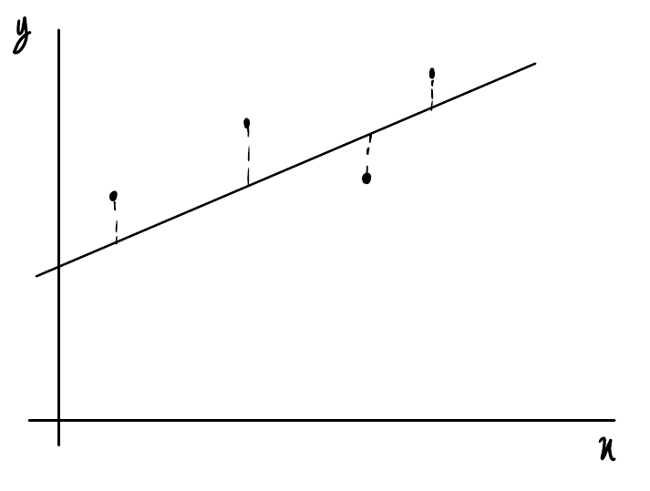

# Derivation

30 October 2026 09:50

Goal:

Based on training data find the best possible line to predict future data points.

Line Equation (1d):

$y = wx + b$

Loss Function:

Mean Squared Error. $L = (wx + b - y)^2$ (This is for 1 data point)

Goal is to minimise the squares of the differences between the line and the points. This is achieved through gradient descent.

We need to optimize "w" and "b", therefore we define a loss function with these as parameters:

$$L(w, b) = \frac{1}{n} \sum_{i=1}^{n} \left(w x_i + b - y_i\right)^2$$

To use the gradient descent algorithm we need to find the gradient of the loss with respect to each parameter at each point, to do this we compute the partial derivative of each parameter (in this case "w" and "b") then substitute "x" values into these derivatives to find gradients.

$$\frac{\partial L}{\partial w} = \frac{\partial}{\partial w}\left(w x_i + b - y_i\right)^2 = 2\left(w x_i + b - y_i\right)(x_i) = 2 x_i \left(w x_i + b - y_i\right)$$

$$\frac{\partial L}{\partial b} = \frac{\partial}{\partial b}\left(w x_i + b - y_i\right)^2 = 2\left(w x_i + b - y_i\right)$$

Now we have general equations for the gradients of the Loss function with respect to each parameter at any point, so to find the mean gradient of each parameter we use these expression:

$$\frac{1}{n} \sum_{i=1}^{n} 2 x_i \left(w x_i + b - y_i\right) = \frac{2}{n} \sum_{i=1}^{n} x_i \left(w x_i + b - y_i\right)$$

$$\frac{1}{n} \sum_{i=1}^{n} 2 \left(w x_i + b - y_i\right) = \frac{2}{n} \sum_{i=1}^{n} \left(w x_i + b - y_i\right)$$

Therefore to update the parameters "w" and "b" we use the equations:

$$w_{\text{new}} = w_{\text{old}} - \left(\left(\frac{2}{n} \sum_{i=1}^{n} x_i \left(w x_i + b - y_i\right)\right) \times \text{learning rate}\right)$$

$$b_{\text{new}} = b_{\text{old}} - \left(\left(\frac{2}{n} \sum_{i=1}^{n} \left(w x_i + b - y_i\right)\right) \times \text{learning rate}\right)$$
